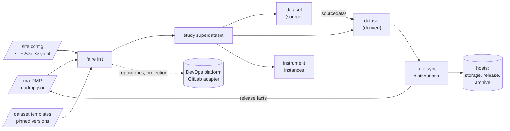
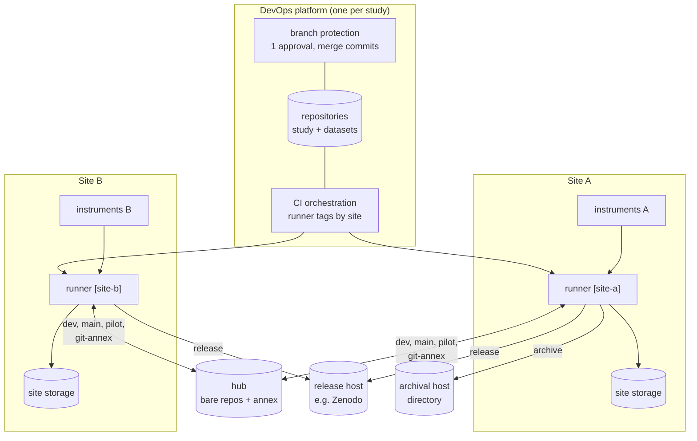
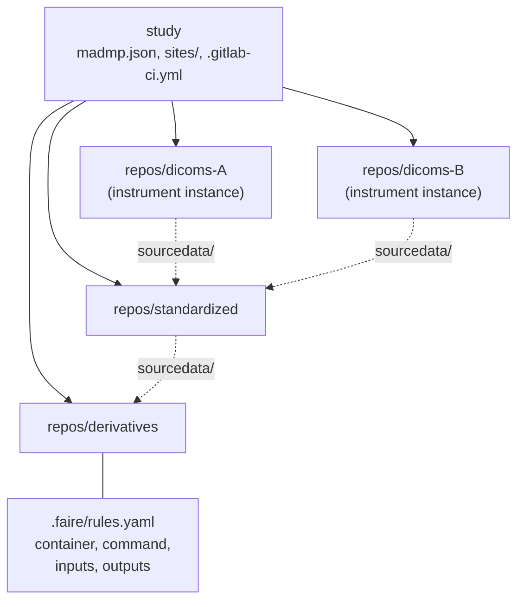
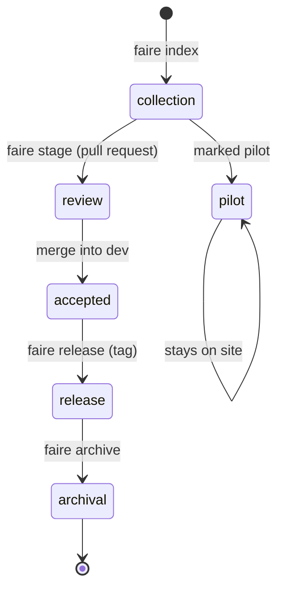
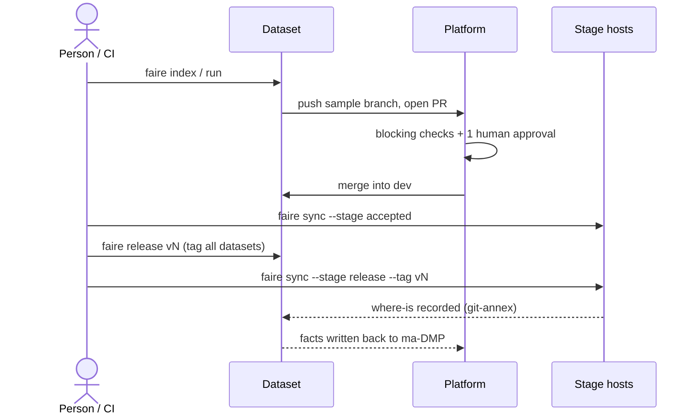
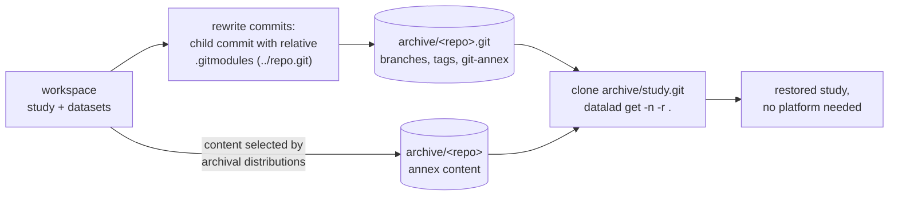
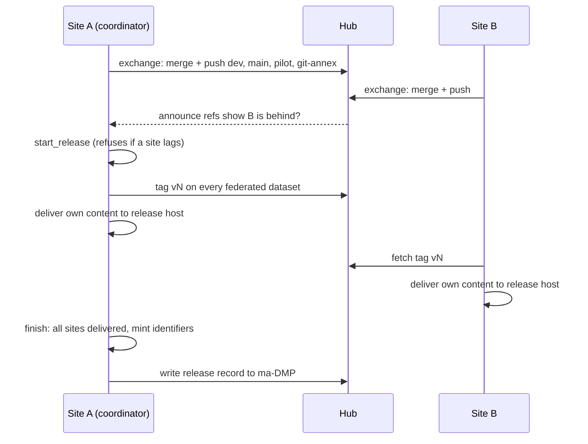

# faire user guide

`faire` operates a study described by a machine-actionable DMP (ma-DMP). Each dataset of the
plan becomes a DataLad dataset; processing, review, distribution, release and archival are
commands that CI jobs and people run alike. Everything below works against the example in
`examples/madmp/`.

## Overview

The ma-DMP is the single input. `faire` turns it into repositories, runs processing, moves
content between hosts as the lifecycle advances, and writes facts back to the plan.



### Infrastructure

One platform orchestrates the jobs. Sites hold the data and run the jobs tagged for them; in a
federated study the hub is the only place sites exchange history.



### Repository structure



## Quick-start (local only, no platform)

```sh quickstart
faire validate $OUT/madmp.json
faire init $OUT/madmp.json --site a --sites-dir $OUT/sites --root $OUT/ws --study-template templates/study --dry-run
faire init $OUT/madmp.json --site a --sites-dir $OUT/sites --root $OUT/ws --study-template templates/study
faire init $OUT/madmp.json --site a --sites-dir $OUT/sites --root $OUT/ws --study-template templates/study
```

`$OUT` is a directory prepared by `python examples/gitlab-demo/build.py $OUT`, which writes a
ma-DMP whose templates are the ones of this repository, a site configuration and a container
collection. The last command repeats the previous one and changes nothing.

## ma-DMP profile

The ma-DMP is a valid RDA DMP Common Standard v1.3 document. Everything faire adds sits under
one property, `faire`, on `dmp`, `dataset`, `distribution` and `host`; removing it leaves a plain
standard document. `faire validate FILE` checks both the standard and the profile.

| Where | Property | Meaning |
|---|---|---|
| `dmp.faire` | `sample_entities`, `hub`, `coordinator` | entities naming a sample; the hub host; the coordinating site |
| `dataset.faire` | `template`, `sources`, `releases` | template (repository, pinned version, parameters); `triggering` or `resource` role per source; release records written by the tool |
| `dataset.related_identifier` | `IsDerivedFrom` | provenance: the dataset is derived from the identified one |
| `dataset.technical_resource[].faire` | `instrument_id`, `site` | instruments; a dataset with instruments is a stream, one repository per instrument |
| `distribution.faire` | `stage`, `filter`, `two_way` | `collection`, `review`, `accepted`, `release` or `archival`; a git-annex matching expression; hub exchange |
| `host.faire` | `site_dependent`, `method`, `parameters`, `secrets`, `long_term` | where content goes; secrets are names, never values |

## Site configuration

One file per site, `sites/<site>.yaml` in the study superdataset: the mapping from the ma-DMP's
site-dependent host names to that site's storage, runner tags, and in a federated study the hub.

```yaml
site: a
hosts:
  Site storage: {type: directory, parameters: {directory: /data/a/storage}}
runners: {tags: [site-a]}
hub: {url: /srv/hub}          # federated studies only; repositories are <url>/<name>.git
```

Secrets are named (`secrets: {token: ZENODO_TOKEN}`) and held by the platform.

## Bootstrap

```sh
faire init madmp.json --site a --sites-dir sites --root ws --study-template templates/study --dry-run
faire init madmp.json --site a --sites-dir sites --root ws --study-template templates/study --platform gitlab --platform-url https://gitlab.example.org --group study
```

`init` creates each dataset from its pinned template, installs sources under `sourcedata/`,
creates the storage remotes of the `collection`, `review` and `accepted` distributions with the
filters as wanted-content rules, registers everything in the study superdataset and, with a
platform, creates and protects the repositories (merge-only branches, one human approval, merge
commits only). Run again it applies additions and reports other differences.

## Processing rules

Each dataset carries `.faire/rules.yaml`: a container name, a command, per-source input
patterns (`required` inputs that match nothing end the run without change), output patterns
and artifacts, parameterised by the sample entities.

```sh
faire plan --dataset DIR --json
faire run --dataset DIR --all
faire test --dataset DIR --list
```

`plan` lists due tasks (state-based: inputs differ from those recorded in the last run record);
`ci render` turns the list into a pipeline; `run --task ID` runs one task.

## Lifecycle and the pilot stream

A sample goes `collection` (indexed in a source dataset), `review` (pull request on a sample
branch), `accepted` (merged into `dev`), `release` (tagged), `archival`. Samples marked pilot go
to the long-lived `pilot` branch, never to `dev`, and their content never leaves the site.



Every stage has its own distributions, so content moves only as far as the stage allows:



```sh
faire index INCOMING --stream dicoms --madmp madmp.json --site a --sites-dir sites
faire stage --dataset DIR
faire reprocess 'subject=01,session=003' --dataset-id standardized
```

Merging a sample's pull request triggers the datasets derived from it, one level at a time.

## Distribution

```sh
faire sync --stage review --dataset DIR --madmp madmp.json --site a --sites-dir sites
faire sync --stage release --tag v1 --study STUDYCLONE --dataset DIR --madmp madmp.json --site a --sites-dir sites
```

`sync` fulfils the distributions bound to a stage: git-annex transfers (the dataset records
where each file is), filters enforced as wanted-content so a sensitive file never leaves, remotes
of `release` and `archival` created on first use. A missing secret fails that distribution by
name; the others still run. With `--tag` and `--study`, a complete release records issue date,
size, access location and a release record (with identifiers minted by hosts that have an
identifier system) in the ma-DMP, committed by the automation identity.

## Releases and archival

```sh
faire release v1 --site a --platform-url https://gitlab.example.org --group study
faire archive --root ws --madmp madmp.json --site a --sites-dir sites
```

`release` tags every dataset's `dev` as one release or refuses, naming the datasets behind.
`archive` writes each repository's history and the content of every release to the archival
host (a directory shared by all archival distributions); history is not rewritten, the archive's
branches and tags are child commits whose `.gitmodules` use relative addresses. Restore:
clone `<archive>/study.git`, check out a branch tracking `origin/main` reset to the release tag,
`datalad get -n -r .`, enable the archive remote of each dataset, `datalad get` content.



## Federation

Sites exchange history only through the hub. `faire sync --stage accepted --workspace ws ...`
exchanges every federated dataset (those with a two-way distribution) in provenance order:
`dev`, `main`, `pilot` are merged and pushed; `*.tsv`, `CHANGES` and `.gitmodules` merge by
union; `sourcedata/` pointers by ancestry; anything else stops that dataset and is reported.
A site joins by running `init` after the first site synchronised: federated datasets are
installed from the hub, the site's own instruments are added. Release and archival are started by
the coordinator and delivered by each site (library: `faire.federation`: `start_release`,
`deliver`, `finish`); only the coordinator writes the ma-DMP.



## Platform setup and required secrets

Platform access goes through one adapter (GitLab implemented). `init` reports the secrets the
plan needs and the platform lacks, by name. Typical: `ZENODO_TOKEN` for a Zenodo release host,
`FAIRE_PLATFORM_TOKEN` for the tool itself. Protected-variable access on sample branches needs
the tool's branch patterns to be protected, which `init` does. Pull requests must be merged
with a merge commit, never squashed: the run records live in commit messages.
