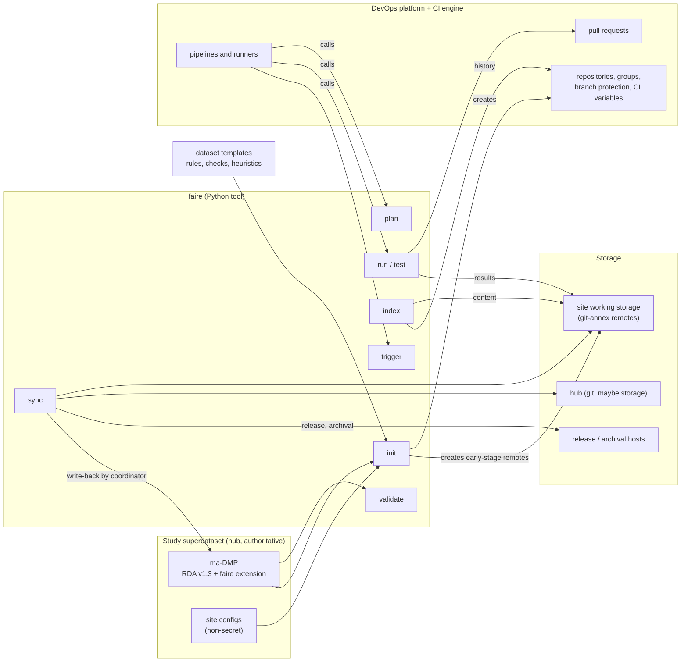
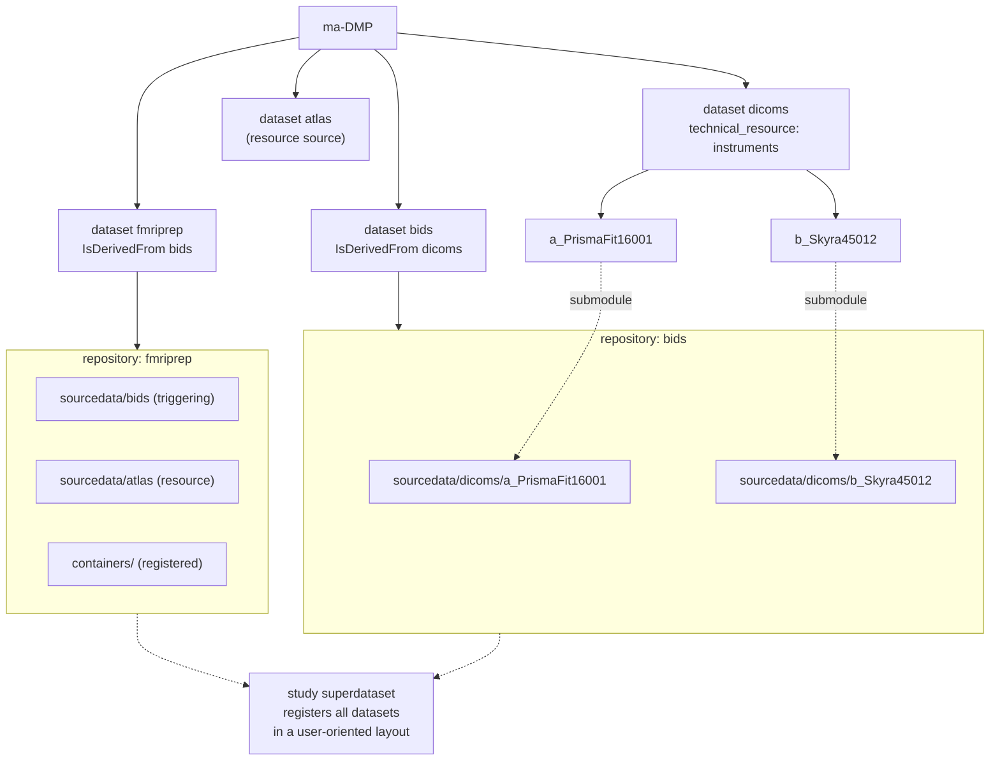
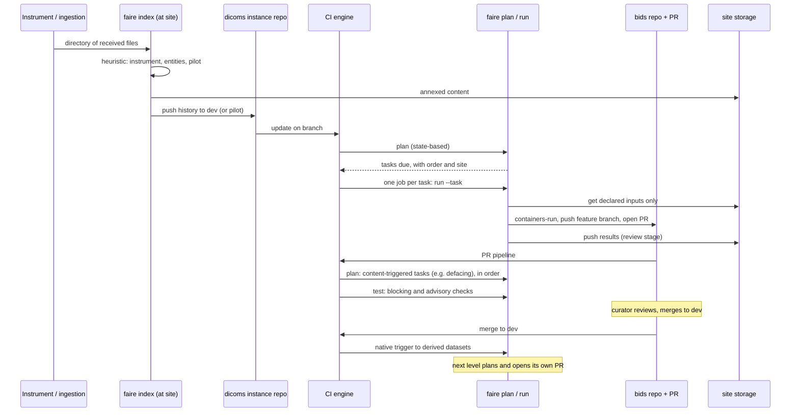
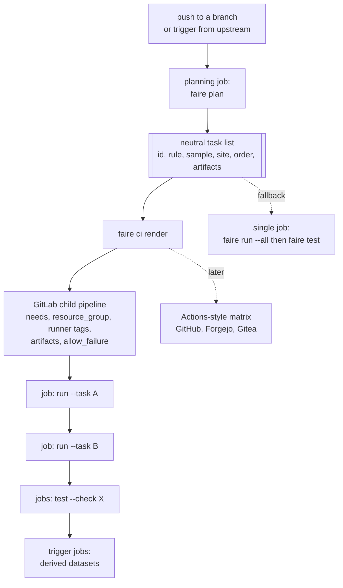
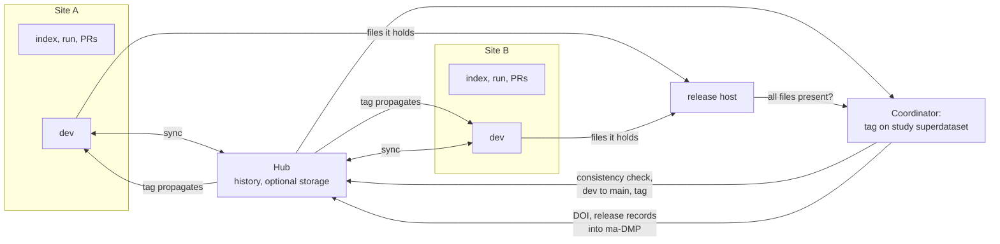

# Diagrams: ma-DMP, faire and the DevOps/CI engine

Illustrative companion to `design.md`. Not an OpenSpec artifact; the specs remain normative.

## 1. Components: ma-DMP, `faire`, platform, storage

## 2. How the ma-DMP becomes repositories

## 3. One sample, from instrument to derivative

## 4. Plan, render, run inside the CI engine

## 5. Lifecycle stages, release and federation

Stages: `collection`, `review`, `accepted`, `release`, `archival`.

